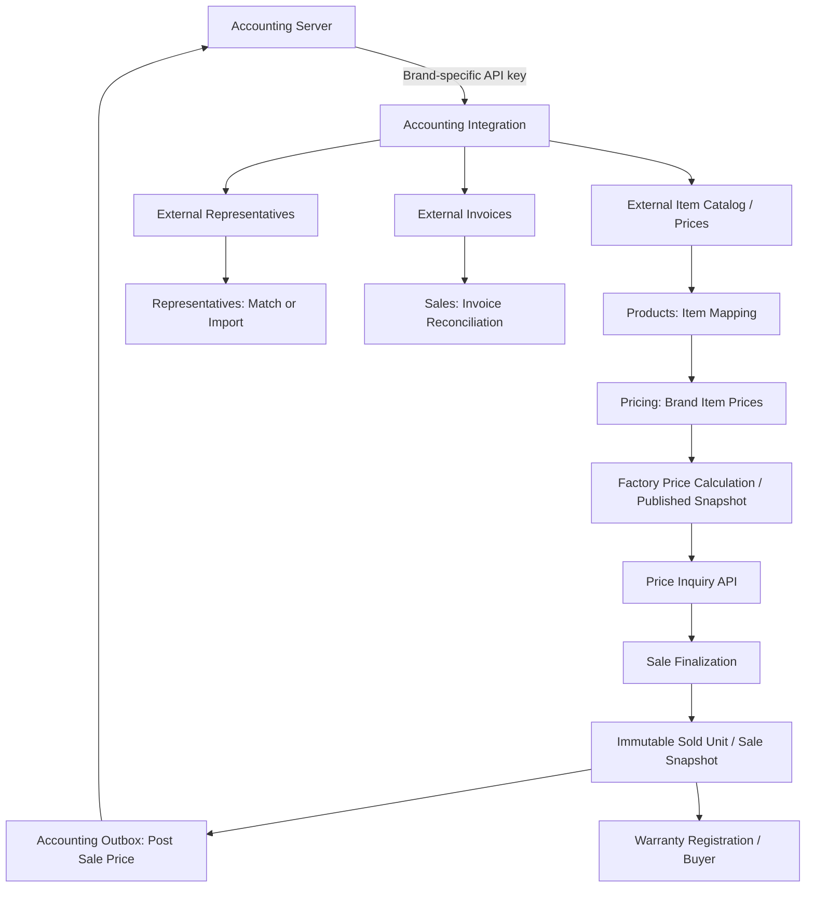

# Kahrad Pricing — Codex Implementation Specification

**Area:** Accounting Integration, Product Item Mapping, Representative Import/Mapping, Invoice Synchronization, Price Updates, Sale Registration, and Price History Protection
**Target stack:** .NET 10 / ASP.NET Core Web API / EF Core / SQL Server / Hangfire / Redis (where already applicable) / Angular administration application
**Architecture:** Modular Clean Architecture; **do not introduce CQRS, MediatR, Vertical Slice Architecture, Docker, or Kubernetes**
**Status:** Authorized business requirements + implementation guidance. **The accounting server API contract has not yet been supplied.**

> **Instructions for Codex:** Read this entire file before changing code. Inspect the actual repository and existing entities, modules, hosts, DbContexts, migrations, authentication, and conventions first. Reuse existing names/types and patterns rather than creating duplicates. Implement everything that can safely be implemented locally, but do **not fabricate** accounting API URLs, request/response payloads, authentication header formats, identifiers, or invoice semantics. Use an interface-driven adapter and realistic tests/fixtures until the real API specification is supplied.

---

## 1. Business context and confirmed decisions

Kahrad Pricing supports multiple independent brands (currently Kahrad and Rodoro). Each brand has its own accounting API key, item catalog, representatives, and invoices. Pricing is based on product components. The system calculates prices for a current catalog but must preserve historical prices of individual sold product units.

### 1.1 Accounting integration requirements

1. Fetch **all accounting items and their prices** from the accounting server **per brand**, using that brand's own API key.
2. Fetch **representatives for each brand**; a representative belongs to a brand for pricing and synchronization purposes.
3. Fetch **invoices for each brand** from accounting.
4. In the **Products administration area**, provide manual management of the mapping between **locally defined product/pricing items** and **items received from accounting**.
5. For representatives, provide **matching/reconciliation** against accounting records **and the ability to import representatives into Kahrad** from accounting.
6. After an actual product sale is finalized, **register/post the sold product's sale price to accounting** using the correct brand connection. Make the operation reliable and idempotent.
7. The specific accounting API details will be provided later. Design extension points now; no guessed endpoints or fake production integrations.

### 1.2 Pricing requirements already agreed

1. Show three prices (to authorized audiences):
   - `ProductionCost`: sum of product item unit price times quantity used.
   - `RepresentativePrice`: factory's price to the representative.
   - `CustomerSellingPrice`: representative's price to the end customer.
2. Factory pricing policy is **brand-specific**: beauty %, factory sales %, commerce %; optional representative factor and warranty amount still need exact business definitions.
3. Representative/customer pricing uses an **algebraic sum**, not compounded discounts:
   `netPercentage = RepresentativeSalesPercentage - GeneralDiscountPercentage - ProductDiscountPercentage`.
4. A representative must **never sell below their purchase price**. Validate the raw price *before* rounding; do not let rounding mask a loss.
5. Factory-to-representative and representative-to-customer selling prices are **rounded upward in steps of 5,000**. For example, 120001 -> 125000; 125000 -> 125000; 125001 -> 130000. `ProductionCost` remains an unrounded calculated cost unless another rule is agreed.
6. A product can have a **fixed factory selling price** OR use a calculated one, and can have a **manual additive amount** such as +5,000. The manual adjustment is separate from `ProductionCost`. See the proposed precise semantics in section 7.
7. When item prices change, **current/un-sold catalog prices can be recalculated**, but **finalized sold product unit prices must never be recalculated or overwritten**.
8. Buyer/end-customer details must be stored during warranty registration and linked to the sold product unit.
9. Prior architecture decisions: SQL Server is the source of truth; Redis can serve published/current prices; a Worker uses Hangfire for scheduling; avoid core business logic in controllers, Workers, or EF Core repositories.
10. Products also supports multilingual product names (Persian/Arabic/English and more later), manual translations, shared feature/specification definitions, and localized API responses. **Do not break or redesign these areas while implementing accounting integration.**

### 1.3 Not yet confirmed — model as configurable or document clearly

- Accounting server `BaseUrl`, endpoints, pagination, auth header, schemas, rate limits, timestamp conventions, currency, item units and identifiers.
- Whether imported accounting invoices represent factory-to-representative sales, representative-to-customer sales, returns, or multiple document types. **Do not treat an imported invoice as an automatically finalized end-customer sale.**
- How accounting identifies a sold physical unit, warranty/serial number, and which record accepts posted sale prices.
- Exact application/placement of a factory representative multiplier and warranty fee.
- Whether factory beauty/sales/commerce percentages are additive on cost or compounded. Current working assumption: additive on `ProductionCost`.
- Whether an accounting item can map to multiple local items; **assume one active mapping per local item per brand and one active mapped local item per external accounting item per brand** until clarified.
- Whether a representative can belong to more than one brand. For now, prefer a brand-scoped representative identity, or an existing Brand-Representative association if the repository already has one.

**Coding rule:** Never hide these unresolved requirements behind arbitrary defaults that could produce incorrect money movements. For the external API specifically, keep adapters unconfigured/inactive until real settings and contracts exist.

---

## 2. First task: audit the existing solution

Before creating files:

1. Find the `.sln`/`.slnx` and inspect `Src/BuildingBlocks`, `Src/Modules`, and `Src/Hosts` (or equivalent actual names).
2. Identify the existing Products/Brands/Representatives/Pricing/Sales/Identity modules, if any.
3. Inspect product, item, product-item/BOM, brand, representative, pricing policy, price snapshot, sold product, invoice, and warranty models and migrations.
4. Identify the project's **actual ID types** (e.g., long or Guid), SQL Server schema patterns, DI registrations, API controllers, Swagger grouping, JWT permissions, audit service, existing Job setup, and HTTP resilience policies.
5. Determine whether the Angular admin application and representative admin already exist; inspect their routing and services.
6. Produce a brief **Existing State / Proposed Changes / Compatibility Risks** report before implementation. Do not delete or rewrite functioning modules unnecessarily.
7. Preserve preexisting changes in the worktree; never reset unrelated work or create migrations based on an out-of-date schema.

**Expected hosts from previous project discussions** (verify before using):

- `Kahrad.Pricing.Api`: administration/write and product management endpoints.
- `Kahrad.Pricing.PriceInquiry.Api`: optimized price inquiry/read host.
- `Kahrad.Pricing.Worker`: jobs / scheduled tasks.
- Separate media worker remains untouched.

**API convention:** Existing preference is **POST endpoints**, including query/search endpoints. Use the repository's established route and versioning conventions, and document any necessary exceptions. Integrate with Swagger grouped by relevant controller/tags.

---

## 3. Module boundaries and ownership

Implement through clear module contracts. No cyclic references between Domain projects.

| Area | Owns | Must not own |
| --- | --- | --- |
| `Products` (Catalog) | Products, local items, units of measure, product-item composition, local-to-accounting item mappings management UI | HTTP accounting integration, customer selling price calculation |
| `AccountingIntegration` | Brand connections, external catalogs/mirrors, sync runs, HTTP adapters, external ID translation services, retry/error tracking | Product pricing rules, business ownership of customers/representatives |
| `Representatives` | Local representative master records, brand affiliation, imports/reconciliation and representative mapping management UI | External HTTP communication, factory cost calculation |
| `Pricing` | Brand item price history/current values, brand pricing policies, product price overrides, calculators, current published price snapshots, rep price policies and discounts | Accounting API transport, warranty identity |
| `Sales` | Sold physical units, immutable sale price snapshots, sale finalization, accounting sale-post request/outbox records | Mutating historical prices after finalization |
| `Warranty` | Warranty registration, buyer link, coverage dates; customer data integrated with existing Customer/Identity model if present | Repricing sold units |

**Dependency design:** `AccountingIntegration` reads/writes module-owned data through explicit Application interfaces/services and events, not by changing another module's DbContext entities behind its back. `Pricing` consumes read-only product compositions and brand item prices. `Sales` captures immutable pricing snapshots at finalization. Use IDs across boundaries. If a shared DbContext already exists, still preserve logical ownership.

### Logical data flow



---

## 4. Accounting connections: securely isolated by brand

### Suggested data model: `AccountingBrandConnection`

Use the actual repository ID type (do not assume Guid):

| Field | Description |
| --- | --- |
| `Id` | PK |
| `BrandId` | Required and unique per integration/provider (or `(BrandId,Provider)` if multiple providers already exist) |
| `ProviderCode` | E.g. `MainAccounting`; optional until multi-provider needed |
| `BaseUrl` | Account server base address configured by administrator |
| `ApiKeySecretReference` | Reference to secure credentials storage; **no plaintext key returned by API** |
| `IsEnabled` | Enable/disable syncing |
| `LastSuccessfulItemSyncUtc` | Diagnostic checkpoint (prefer per-sync checkpoints instead of one generic timestamp) |
| `LastSuccessfulRepresentativeSyncUtc` | Diagnostic checkpoint |
| `LastSuccessfulInvoiceSyncUtc` | Diagnostic checkpoint |
| `RowVersion` | Optimistic concurrency where supported |

Authentication keys and URLs must be selected by **brand**, not global configuration. Never log API keys, auth headers or raw credential configuration. Encrypt secret values at rest via the existing secure configuration mechanism; use a secret reference when supported.

Provide a test-connection service **only once the external API contract is known**. Respect key rotation and separate environment settings. Fail closed when key is missing. Do not send Kahrad's credential on Rodoro requests.

Implement named/typed `HttpClient` provider adapter with cancellation, bounded timeouts, Polly/resilience if already used, safe retry policy for reads, and server-side concurrency/rate limiting appropriate to the eventual provider contract.

### Adapter contracts — do not invent real DTOs

```csharp
public interface IAccountingProviderClient
{
    Task<ExternalPage<ExternalItemDto>> GetItemsAsync(
        AccountingConnectionContext context,
        string? continuationToken,
        CancellationToken cancellationToken);

    Task<ExternalPage<ExternalRepresentativeDto>> GetRepresentativesAsync(
        AccountingConnectionContext context,
        string? continuationToken,
        CancellationToken cancellationToken);

    Task<ExternalPage<ExternalInvoiceDto>> GetInvoicesAsync(
        AccountingConnectionContext context,
        string? continuationToken,
        CancellationToken cancellationToken);

    Task<ExternalSalePostResult> PostSoldProductPriceAsync(
        AccountingConnectionContext context,
        ExternalSalePriceCommand command,
        CancellationToken cancellationToken);
}
```

These are **application-side abstract contracts / placeholders**; define their DTO fields only from real provider documentation when received. Build a test fake using fixtures, and keep the production provider adapter explicitly `NotConfigured`/disabled until the API contract is implemented. `ExternalPage<T>` must represent pagination/continuation accurately once known. Do not assume the provider supports it.

---

## 5. Inbound sync: items and accounting item prices

### 5.1 Separate external item mirror from local catalog items

Suggested entities:

- `AccountingItem`: `Id`, `BrandId`, `ExternalItemId`, `ExternalCode?`, `Name`, `ExternalUnit?`, `IsPresentInLatestSync`, `LastSeenAtUtc`, `ExternalUpdatedAtUtc?`, `RawPayloadHash?`.
- `AccountingItemPrice`: `Id`, `BrandId`, `AccountingItemId`, `Amount`, `CurrencyCode`, `ExternalEffectiveAtUtc?`, `ObservedAtUtc`, `SourceSyncRunId`.
- `AccountingItemMapping`: `Id`, `BrandId`, `LocalItemId`, `AccountingItemId`, `UnitConversionFactor`, `IsActive`, `CreatedAtUtc`, `UpdatedAtUtc`, `MappedByUserId?`.
- `BrandItemPrice`: price approved/published for local `Item` **in a specific brand**, together with provenance and effective/version information. Pricing owns this projection/history, not the Products master item record.

Local items and their product compositions **must not be overwritten** by an accounting catalog sync. The imported mirror is read-only data from accounting; the mappings are user-managed links to it.

For item mapping, maintain one active mapping per `(BrandId,LocalItemId)`; and, as an initial rule, one active mapping per `(BrandId,AccountingItemId)`. Add unique indexes/filtered indexes as appropriate. **Scope all external identifiers to BrandId**, because separate brands may reuse the same external IDs.

If the repo permits shared item definitions across brands, a shared `Item` can have separate `AccountingItemMapping` and `BrandItemPrice` per brand.

### 5.2 Price sync rules

1. Fetch complete accounting item list per brand; support pagination if the external provider uses it.
2. Upsert mirror records by stable `(BrandId,ExternalItemId)`; do not match automatically on item names.
3. Validate amount, currency, units and freshness. Do not silently set missing or invalid prices to `0`.
4. Save observed external price changes with provenance/history; avoid duplicating an unchanged price on every sync.
5. Convert a mapped accounting item price to the local item's configured pricing unit **only if a validated conversion factor and correct currency semantics are available**.
6. Update/publish `BrandItemPrice` for mapped, valid records through Pricing-owned services.
7. Trigger **affected product** recalculation via an outbox event (e.g. `BrandItemPriceChanged`) rather than synchronously recomputing the whole catalog in an HTTP request.
8. Unmapped accounting items are visible in admin with status `Unmapped`; they **must not** change local item prices.
9. Mapped local items with an absent/invalid external price get a clear `MissingPrice`/`InvalidPrice`/`StalePrice` state. Do not automatically publish a new product selling price with incomplete cost inputs.
10. Avoid auto-deleting records absent from a fetched list; only mark `NotSeen` after a **verified complete** sync, and handle temporary API errors/pagination failure without false deletions.
11. For a new product with incomplete mapped item price inputs, block first price publication and return a meaningful admin warning. For an existing product, retain the most recent valid **published** price with an explicitly reported staleness state until a valid replacement is available.

**Production cost:** `sum(BrandItemPrice × ProductItem.UsedQuantity)` after correct unit conversion. Price is scoped to `Product.BrandId`.

### 5.3 Products admin: `Item Accounting Mapping`

Add a manageable screen under Products (reuse existing Angular admin architecture where present):

- Select brand, search local item and external accounting item, filter `Mapped`, `Unmapped`, `Invalid`, `Missing Price`.
- Side-by-side local item name/code/unit and external item name/code/unit/current external price/last sync.
- Search by code, name, and stable external ID; optionally show match suggestions, but **no automatic binding by name**.
- Create/change/unmap mapping; require the proper admin permission and confirmation on reassignment.
- Editable validated unit conversion factor; display computed local price and precise unit labels.
- Conflict feedback for duplicate mapping, wrong brand, ambiguous match, incompatible units and in-flight sync updates.
- Audit who changed mapping, old/new values, and timestamp.
- Provide summary counters for `Total Local`, `Total External`, `Mapped`, `Unmapped`, `Invalid`, `Last Sync`.
- Changes to mappings should schedule the relevant price recomputations and invalidate affected published price caches safely.

---

## 6. Inbound sync: brand representatives, mapping, and import

Representatives are **brand-scoped for syncing and pricing**. Reuse existing representative entities where possible; avoid two competing master records.

### 6.1 Suggested entities

- `AccountingRepresentative`: imported mirror with `BrandId`, stable `ExternalRepresentativeId`, name/code/status, last-seen stamp and non-sensitive contact fields as provided by accounting.
- `RepresentativeAccountingMapping`: `BrandId`, `RepresentativeId`, `AccountingRepresentativeId`, `IsActive`, timestamps and actor info.
- Existing `Representative`/brand association: authoritative local identity for admin login/authorization and representative pricing policy.

Unique constraints (where existing data rules permit):

- `(BrandId, ExternalRepresentativeId)` in external mirror.
- One active external mapping per local representative *per brand*.
- One active local mapping per accounting representative *per brand*.

### 6.2 Two supported workflows

**Match an existing representative:**

1. Sync external representative mirror.
2. Admin selects an existing local representative and an external accounting representative in the **same brand**.
3. Detect ambiguity/duplicates; verify mapping and save with audit.
4. Future syncs update the external mirror and permitted fields only, not local user access/security roles.

**Import a new representative from accounting:**

1. Admin selects one or more `Unmapped` external representative records (optionally bulk selection).
2. System previews fields and matching candidates by code/contact as **suggestions**, not automatic identity matches.
3. Confirm import; create local representative with `BrandId`, safe defaults and relevant external fields.
4. Create mapping atomically with representative creation; repeated imports must be idempotent.
5. Do **not** grant privileged identity roles, create passwords, or send OTPs automatically unless a separate onboarding process explicitly permits it.
6. Pricing policy defaults must be an explicit configured business choice; do not assign guessed profit/discount percentages.

Support a reconciliation screen with `Imported`, `Mapped`, `Unmapped`, `Conflict`, `InactiveExternally`, and import preview/result. **External deletion/inactivation must not silently delete a local representative or their historical sales.**

### 6.3 Consistency with representative price rules

The representative's general sales markup/discount policy and per-product discounts remain **local Pricing data**. They are not overwritten when accounting representatives are synchronized. A representative must not sell below purchase price; when changing a policy, validate its impact on active product-specific discounts, as defined in the Pricing Domain.

---

## 7. Product price calculations, overrides, and immutable sales

Accounting integration must honor existing/new Pricing Domain boundaries and the three price tiers.

### 7.1 Price definitions

```text
ProductionCost = SUM(ProductItem.QuantityUsed × BrandItemPrice.PriceInMatchingUnit)

FactoryFormulaPrice = ProductionCost × (
    1 + (Brand.BeautyPercent + Brand.FactorySalesPercent + Brand.CommercePercent) / 100
)

# Representative factor and warranty fee are still provisional business concepts.
FactoryCalculated = FactoryFormulaPrice × RepresentativeFactor

FactoryBase = (FactorySellingPriceMode == Fixed)
    ? FixedFactorySellingPrice
    : FactoryCalculated

RepresentativePrice = RoundUpToStep(
    FactoryBase + ManualFactoryPriceAdjustment + WarrantyPrice,
    5000
)

NetPercent = RepresentativeSalesPercent
    - RepresentativeGeneralDiscountPercent
    - RepresentativeProductDiscountPercent

RawCustomerPrice = RepresentativePrice × (1 + NetPercent / 100)
REQUIRE RawCustomerPrice >= RepresentativePrice  # before rounding
CustomerSellingPrice = RoundUpToStep(RawCustomerPrice, 5000)
```

Use `decimal` in .NET and SQL Server. Keep the existing project's currency convention consistent and **do not assume amounts are IRR vs toman**. Once the currency is established, enforce currency conversion and display rules explicitly.

For now, this formula is a documented *working design*, not authority to silently change an existing approved formula. Confirm whether the repo already encodes a different approved rule; preserve it unless requirements are reconciled.

### 7.2 Price override model

Propose `ProductFactoryPriceOverride`, owned by Pricing and scoped to product (with brand inferred from product):

| Field | Meaning |
| --- | --- |
| `ProductId` | Unique per product |
| `FactorySellingPriceMode` | `Calculated` or `Fixed` |
| `FixedFactorySellingPrice` | Non-null and positive when mode=`Fixed` |
| `ManualFactoryPriceAdjustment` | Non-negative additive amount, defaults to `0` |
| `UpdatedByUserId`, `UpdatedAtUtc`, `RowVersion` | Audit and concurrency |

`ProductionCost` must **still be recalculated from items** even when a fixed factory selling price is enabled; the fixed value overrides only the factory sales price component. Changing item prices must not silently overwrite `FixedFactorySellingPrice` or `ManualFactoryPriceAdjustment`. Warranty (if charged) and manual adjustment are **not** added to production cost.

The exact stacking order of optional warranty and factory multiplier remains provisional. Separate these operations in code so a later rule adjustment does not require redesign.

### 7.3 Sold units and immutability

**Never freeze the entire product catalog record just because one physical unit sold.** Freeze **the finalized sale/unit price snapshot**; permit current product definition and price to evolve for unsold/future units.

On sale finalization, store at least:

- `SoldProductUnitId` / actual serial or warranty code when available.
- `ProductId`, `BrandId`, `RepresentativeId`, sale date/time.
- `ProductionCostSnapshot`, `RepresentativePriceSnapshot`, `CustomerSellingPriceSnapshot`.
- Currency, applied policy and price snapshot version IDs, any manual override amounts.
- Accounting posting status/correlation, external sale/invoice reference if provided.
- Buyer/customer link when identified, or link later during warranty registration.

After finalization, **do not recompute or update the three recorded monetary amounts**, even on item-price sync, policy changes, manual overrides, invoice import or retries. If correction/refund is needed, use a documented adjustment/reversal transaction with audit history rather than mutating the original sale price snapshot.

### 7.4 Buyer and warranty

- Reuse the existing Customer entity/Identity model if present; otherwise create a minimal customer profile (name, mobile, optional national code) using the existing privacy/security standards.
- Link `WarrantyRegistration` to `SoldProductUnit` and the purchaser/customer; store registration timestamp and separate warranty start/end date fields.
- Protect personal information through appropriate permissions and audit logs; **do not expose buyer details via public price inquiry**.
- Actual sale date and warranty registration date are distinct.
- Unique serial/warranty card code logic and warranty duration are pending business clarification; do not invent them.

---

## 8. Inbound sync: invoices from accounting

Invoices are fetched **per brand** with that brand's credentials, following the same source isolation rules.

### 8.1 Minimum storage and reconciliation

Propose external invoice mirrors such as:

- `AccountingInvoice`: `Id`, `BrandId`, `ExternalInvoiceId`, `ExternalRepresentativeId?`, `InvoiceNumber?`, `IssuedAtUtc?`, `ExternalStatus`, `CurrencyCode`, `GrossTotal?`, `LastSeenAtUtc`, `SourceSyncRunId`.
- `AccountingInvoiceLine`: `AccountingInvoiceId`, stable external line identity (if available), item/product identifiers, quantities, unit price, line total.
- `InvoiceReconciliation`: optional mapping to local representative and local sale/units, with `Unmatched`, `Matched`, `Conflict`, `RequiresReview` states.

Use a composite uniqueness `(BrandId,ExternalInvoiceId)`. A fetched invoice update must be an idempotent upsert of its **external mirror**, never a rewrite of a finalized local sold unit's monetary snapshot.

### 8.2 Do not infer what an invoice means

An accounting invoice may be a wholesale sale to a representative, a retail sale, a return, a correction or another document. Until the actual provider schema and user rules are supplied:

- Import and display invoices with per-brand filters and sync status.
- Match representative via its verified accounting mapping where possible; otherwise mark unmatched.
- Do not auto-create an end customer, warranty, or immutable sold unit solely on the basis of an imported invoice.
- Do not consider every invoice proof of product sale for outbound posting.
- Do not allow inbound invoice updates to overwrite local finalized sale prices.
- Make reconciliation a separately executable service with audited manual actions.

---

## 9. Outbound: register sale price with accounting

When the **local business workflow confirms a sale is finalized**, capture an immutable sold-unit snapshot **and** create an outbound accounting registration request in the **same SQL Server transaction** using a transactional outbox.

### Required behavior

1. Resolve `BrandId` from the sold unit/product, verify the matching accounting connection and mapped external representative where the external API requires it.
2. Persist final sold product snapshot; insert an `AccountingSalePostOutbox` record with a stable local idempotency key such as `SoldProductUnitId + OperationType + Revision` (use a correction event for revisions, not silent overwrite).
3. Worker picks pending records, sends using the correct brand API key, and records request correlation/result without logging credentials or personal data.
4. Retries use exponential backoff plus jitter, bounded retry count, and `Failed`/`RequiresManualReview`/dead-letter status. Never generate a new external sale from duplicate delivery.
5. Provider-side idempotency: use an idempotency key if the accounting API supports it; otherwise implement a **read-before-retry/reconciliation** workflow when the provider exposes a reliable reference lookup. Never claim exactly-once delivery on an API that cannot guarantee it.
6. If posting fails, **the local sale remains finalized** and immutable; the posting status remains pending/failed for operator follow-up. Do not alter price snapshots.
7. Inbound invoices and outbound sale posts must be correlated using external references to avoid double entry or creating feedback loops.
8. Pending outbound records survive process restart, Redis failure, network outage and Worker interruption.

Suggested posting states: `Pending`, `InProgress`, `Succeeded`, `RetryScheduled`, `Failed`, `RequiresManualReview`.

Because the real API contract is not available yet, implement the outbox and interfaces now; posting should not run against a guessed URL or fake production endpoint.

---

## 10. Sync execution, transactions, and reliability

Create independent jobs **per brand and data type**:

- `SyncAccountingItemsJob(brandId)`
- `SyncAccountingRepresentativesJob(brandId)`
- `SyncAccountingInvoicesJob(brandId)`
- `ProcessAccountingSaleOutboxJob()` (or per-brand partition if operationally useful)
- `RecalculateAffectedProductPricesJob(brandId, ...)` through the existing Pricing Worker

Use Hangfire **if it is already installed/selected** in the solution; do not create competing schedulers.

### Sync state

A `AccountingSyncRun` (and optional `AccountingSyncCheckpoint`) should record:

- `Id`, `BrandId`, `SyncType`, `StartedAtUtc`, `CompletedAtUtc`, `Status`.
- Rows fetched/changed/unmatched/invalid; last safe continuation checkpoint when supported.
- Sanitized error category/message, correlation ID, attempt number.
- Whether a full-list scan completed successfully; only then update `IsPresentInLatestSync` status.

Requirements:

- Per-brand isolation and single-flight execution for the same `(BrandId,SyncType)` (distributed lock/DB-backed mechanism as appropriate).
- Stable external ID upserts and idempotency on re-run; no duplicates.
- Robust paging/cursor handling after partial failure; **do not mark a partial scan as successful**.
- Short SQL transactions for batches; do not hold a DB transaction open during HTTP calls.
- Cancellation, timeouts, structured logs, progress metrics and health checks.
- Brand-specific synchronization frequency configurable in admin/configuration; **do not invent a real schedule** before business agreement.
- Change events through an outbox, with asynchronous recalculation and Redis invalidation; avoid cache invalidation before database publication.
- Publishing a new product price should be atomic in SQL Server (snapshot + current published pointer); never expose a half-calculated price.
- A broken provider or network disconnection must not block price inquiry of last valid published prices; report staleness for operators.

---

## 11. Pricing refresh and Redis strategy

For approximately **35,000 products**, avoid recomputing every representative's entire price matrix on every item sync.

- Materialize/publish each current `ProductPriceSnapshot` (production cost + factory representative price + applicable policy/override version).
- The Price Inquiry host loads the published factory snapshot, representative pricing policy and that representative's per-product discount, then calculates the final customer price deterministically.
- Cache relevant published snapshots and policies in Redis with version-aware keys or invalidation; use SQL Server fallback only when consistent with the established runtime architecture.
- `BrandItemPriceChanged` identifies affected products through the local ProductItem composition; enqueue only impacted product recalculations.
- Changing a local item mapping, unit conversion, product composition or brand policy likewise schedules affected price recalculation.
- Changing a representative policy or product discount does **not** rewrite factory price snapshots or prior sold-unit snapshots.
- Record `CalculatedAtUtc`, `PublishedAtUtc`, policy version, input item-price version references/checksum, and `IsStale`/`PublicationStatus` as appropriate.

**Publication safety:** Missing/invalid mapped prices should not silently generate free or incorrect product prices. The previous published price is retained with operator-visible warnings when recalculation is blocked.

---

## 12. Administrative API endpoints (proposed; follow existing conventions)

Use authenticated, permission-protected, API-versioned endpoints in the existing API host. Prefer **POST** actions as previously requested. Example semantic routes; adapt to the repository's controller conventions:

| Proposed route | Function |
| --- | --- |
| `POST /api/v1/accounting/connections/list` | List brand accounting connection metadata, never keys |
| `POST /api/v1/accounting/connections/save` | Create/update brand connection with secure secret handling |
| `POST /api/v1/accounting/sync/items` | Enqueue manual item sync for selected brand |
| `POST /api/v1/accounting/sync/representatives` | Enqueue manual representative sync |
| `POST /api/v1/accounting/sync/invoices` | Enqueue manual invoice sync |
| `POST /api/v1/accounting/sync/history` | Query sync run history and status |
| `POST /api/v1/products/accounting-items/search` | Browse external item mirrors with local mapping state |
| `POST /api/v1/products/accounting-items/map` | Map local item to external item for brand |
| `POST /api/v1/products/accounting-items/unmap` | Unmap and schedule affected repricing |
| `POST /api/v1/representatives/accounting/search` | Browse accounting reps and reconciliation state |
| `POST /api/v1/representatives/accounting/map` | Match an existing local rep to accounting rep |
| `POST /api/v1/representatives/accounting/import` | Preview/confirm import selected accounting reps |
| `POST /api/v1/accounting/invoices/search` | Browse invoices and unresolved linkages |
| `POST /api/v1/accounting/sales/posting-status` | View pending/failed/succeeded sale posts |
| `POST /api/v1/accounting/sales/retry` | Permissioned retry of eligible failed outbound posting |
| `POST /api/v1/pricing/product-override/save` | Fixed/calculated factory selling price mode and manual addition |

Return typed request/response DTOs, FluentValidation (if established), paging and consistent application error codes. Never accept or trust a user-supplied BrandId without checking authorization and ownership. Protect manual sync/import/mapping and retry actions via fine-grained permissions. If Swagger conventions group by `BaseController`, preserve that behavior.

**API response permissions:** Customers must not receive `ProductionCost`, internal representative purchase prices, accounting IDs, API keys, or other brands' data. Admins and correctly authorized representative users may receive only relevant fields.

---

## 13. Suggested SQL Server schema and index checklist

Names are **suggestions**, not commands to duplicate existing tables. Merge into existing domain schema where available.

| Entity/table | Required uniqueness/indexes |
| --- | --- |
| `AccountingBrandConnections` | Unique `(BrandId,ProviderCode)` or `BrandId` if one provider |
| `AccountingSyncRuns` | Index `(BrandId,SyncType,StartedAtUtc DESC)` |
| `AccountingItems` | Unique `(BrandId,ExternalItemId)` |
| `AccountingItemPrices` | `(AccountingItemId,ObservedAtUtc DESC)`; source sync reference |
| `AccountingItemMappings` | Filtered unique `(BrandId,LocalItemId)` active; `(BrandId,AccountingItemId)` active |
| `BrandItemPrices` | Unique current `(BrandId,LocalItemId)` and separate price history/versioning as appropriate |
| `AccountingRepresentatives` | Unique `(BrandId,ExternalRepresentativeId)` |
| `RepresentativeAccountingMappings` | Active unique local/external within brand |
| `AccountingInvoices` | Unique `(BrandId,ExternalInvoiceId)` |
| `AccountingInvoiceLines` | Unique external line ID per invoice when supplied |
| `ProductPriceSnapshots` | `(ProductId,CalculatedAtUtc DESC)` or version; preserve history |
| `PublishedProductPrices` | Unique `ProductId` referencing a valid published snapshot |
| `ProductFactoryPriceOverrides` | Unique `ProductId` |
| `RepresentativeProductDiscounts` | Unique `(RepresentativeId,ProductId)` within local identity scheme |
| `SoldProductUnits` / sale lines | Unique physical serial if required; immutable monetary columns after finalization |
| `AccountingSalePostOutbox` | Unique idempotency key; index `(Status,NextAttemptAtUtc)` |

Use `decimal` with appropriate precision (e.g. `decimal(18,2)` for money and `decimal(9,4)` for percentages where supported), explicit UTC timestamps, foreign keys within owning context and `rowversion` where updates may race.

**Do not add migrations that conflict with existing migrations or rename current primary keys just for this feature.** Generate migrations only after inspecting the solution's EF Core project and existing model conventions. Do not automatically run database migrations against production.

---

## 14. Angular administration screens

If the existing Angular admin project exists and is included in this workstream, add these screens using its current non-standalone/module-based architecture and styles:

1. **Accounting connections by brand:** masked/secure credentials configuration, enabled status, last sync status.
2. **Item mappings (within Products):** local/external catalog browsing, mapping/unmapping, conversion, validation and bulk-friendly filters.
3. **Representative reconciliation (within Representatives):** external records, local match, **import from accounting**, duplicate/conflict preview, status.
4. **Invoice import/monitoring (within Sales or Accounting):** imported invoices by brand and reconciliation status, no premature sale creation.
5. **Sync center:** start authorized sync jobs, see progress/history and errors, retries where permitted.
6. **Sale posting monitor:** pending/retrying/failed/succeeded registrations, safe operator retry.
7. **Product factory price override:** calculated vs fixed and optional additive adjustment; display cost unchanged and resulting factory price.

Support Persian RTL where the app already uses it. Reuse existing authentication, form validation, localization, UI components and API clients. If no frontend source is available, implement backend/API contracts and document the frontend handoff rather than generating a disconnected Angular app.

---

## 15. Tests and acceptance criteria

### 15.1 Unit tests

- Item cost uses brand-specific mapped item price and correct quantity/unit conversion.
- A local item can have different prices/mappings in two brands without leakage.
- Unmapped or invalid external prices never silently become zero in current product pricing.
- Fixed factory price remains fixed after item price update, while `ProductionCost` still changes.
- Manual +5,000 factory adjustment does not change `ProductionCost`; factory selling price rounds up correctly.
- Upward rounding examples: `120001 -> 125000`, `125000 -> 125000`, `125001 -> 130000`.
- Rep pricing: `Net% = Sales% - GeneralDiscount% - ProductDiscount%`.
- Reject rep price **before rounding** if below purchase price; validate policies after changes.
- Sold product price snapshot remains unchanged after new item prices, changed brand policy, changed discount, retry or invoice sync.

### 15.2 Integration tests (use existing project setup; SQL Server fixtures where practical)

- Sync of same brand/items twice is idempotent; changed external price produces one valid new version.
- Identical external item IDs in different brands remain separate.
- Credential selection is strictly per brand (use a fake adapter to assert it).
- Incomplete/paged sync cannot incorrectly mark all missing records inactive.
- Item mapping rejects duplicate active mapping, cross-brand mapping and unsupported unit conversion.
- Representative **import** creates local rep plus mapping only once on repeat call.
- Existing representative **match** is idempotent and does not alter Identity permissions.
- External representative removal does not erase local sales or account history.
- Invoice sync is an idempotent mirror import and cannot overwrite finalized sold sale price.
- One finalized sale creates exactly one local immutable snapshot and one outbound outbox intent.
- Posting retry does not create additional local sold unit records; retry and idempotency handling are recorded.
- Failed provider never corrupts local sale; status is recoverable.
- Existing unrelated product catalog, localized names/features/specifications, API grouping, and migrations remain functional.

### 15.3 Security and operational checks

- API keys not returned, displayed as plaintext, or logged.
- Authorization and tenant/brand ownership checks for each operation.
- Inputs validated and deserialization bounded; safe HTTP timeouts/retries.
- Operator logs do not disclose personal buyer data or auth secrets.
- Accounting API unconfigured => clear `NotConfigured` state, no fake success or guessed HTTP traffic.
- All builds and relevant tests pass; provide commands/results in implementation summary.

---

## 16. Implementation sequence for Codex

Work in reviewable increments. Prefer code that runs with a fake provider and real local repository services, even before the real accounting protocol is known.

### Phase A — inspect, design and domain foundations

1. Audit repository and produce gap analysis.
2. Reuse/extend `Brand`, `Item`, `ProductItem`, `Representative`, and Pricing models.
3. Implement brand-scoped external identity/mirror/mapping entities and indices; use existing ID types.
4. Add Pricing override model (`Calculated`/`Fixed`, manual addition) with validation and tests.
5. Add/strengthen immutable sold-unit/sale snapshot model if not already present; preserve all existing sale data.

### Phase B — integration engine and persistence

6. Implement `AccountingBrandConnection` and secure secret access abstraction.
7. Create `IAccountingProviderClient` plus **fake/test provider**. Real HTTP provider remains unconfigured pending supplied API spec.
8. Create item, representative and invoice synchronization orchestration with brand scope, upsert, SyncRun logging, retry and idempotency.
9. Route mapped valid item prices through Pricing application service and enqueue affected product price refresh.
10. Implement representative map/import and invoice read-only reconciliation.

### Phase C — reliable outbound and public interfaces

11. Implement finalized sale -> immutable snapshot -> transactional accounting outbox, with Worker processing and safe retries.
12. Add permission-protected administration APIs, validators, Swagger, and audit logging.
13. Add Angular admin functionality where matching codebase exists.
14. Add Redis version-aware invalidation and published-price consistency if existing infrastructure supports it.
15. Add unit/integration tests, verify existing behavior, and produce migration scripts following project conventions.

### Phase D — integrate real accounting server when details are supplied

16. Map exact provider DTOs, pagination, units/currency/statuses and errors to the adapter.
17. Implement actual per-brand key authentication and HTTP routes from the **provided** protocol.
18. Run contract tests using approved sandbox responses, reconciliation checks and controlled first sync.
19. Document operations, sync schedules, key rotation, monitoring, and recovery runbook.

**Do not block Phase A–C waiting for the provider spec. Do not claim Phase D is complete before it is supplied.**

---

## 17. Expected Codex deliverables

At the end of the work, provide:

1. A concise audit of existing module structure and reused vs new entities.
2. Implemented code organized in actual Clean Architecture projects with DI registrations.
3. EF Core configurations/migrations (generated, **not** run against production).
4. API request/response contracts, Swagger-visible endpoints and permission names.
5. Working local item mapping and representative import/match flows using fake/synchronized records.
6. Invoice import/reconciliation infrastructure and durable outbound sale-post outbox.
7. Price override, rounding, minimum selling price and sold-snapshot immutability tests.
8. Admin screens where the source is present.
9. Build/test results, assumptions, blockers, migration/rollout notes, and explicit **questions for the real accounting API**.

## 18. Questions to preserve for the accounting API specification

When the user supplies the provider details, clarify and document before writing production HTTP calls:

- Per-brand base URL and authentication header/query format; how API keys are issued and rotated.
- Items endpoint, stable IDs, price fields, price currency, unit measures, update timestamp and pagination.
- Representative IDs, types, assigned brand/status, name/phone/identifier semantics.
- Invoice endpoints, type (factory/retail/return), line semantics, representative references, status/cancellation, cursor/pagination.
- Sale-price posting endpoint, required fields, whether it updates an existing invoice or creates a new entry, idempotency mechanism, duplicate handling and response identifiers.
- Whether the accounting system uses a time-stamped price history, or only latest prices; full sync vs delta support.
- Expected polling schedule, API limits, provider availability, and outage procedures.
- Warranty serial/activation lifecycle and buyer identity requirements.

**Definition of done for this implementation stage:** Local domain rules, persistence, mapping/import/reconciliation orchestration, outbox architecture, safe APIs and tests are implemented against the actual codebase. The provider-specific adapter is visibly pending until the real accounting API contract is received. Current product prices can be updated from mapped accounting item prices without ever changing finalized historical sold prices.
